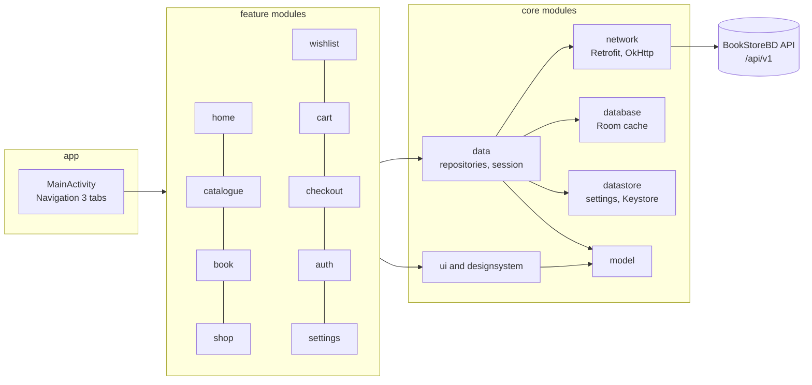

<div align="center">

# 📚 BookStoreBD for Android

**The native Android app for BookStoreBD, the marketplace for new and second-hand books in Bangladesh. Built with Kotlin and Jetpack Compose, it shares accounts, carts and orders with the website, and brings Bangla–English search, a fast offline-friendly catalogue, secure sign-in, light and dark themes and full Bangla support to your phone.**

🌐 **Website:** [bookstorebd-loum.onrender.com](https://bookstorebd-loum.onrender.com) · 🧩 **Website and API source:** [UtshaBasak/BookStoreBD](https://github.com/UtshaBasak/BookStoreBD)

[](https://github.com/UtshaBasak/BookStoreBD-Android/actions/workflows/ci.yml)
[](https://github.com/UtshaBasak/BookStoreBD-Android/actions/workflows/github-code-scanning/codeql)
[](https://github.com/UtshaBasak/BookStoreBD-Android/releases/latest)
[](https://github.com/UtshaBasak/BookStoreBD-Android/releases)
[](https://bookstorebd-loum.onrender.com)
[](LICENSE)

[](https://github.com/UtshaBasak/BookStoreBD-Android/commits/main)
[](https://github.com/UtshaBasak/BookStoreBD-Android/graphs/commit-activity)
[](https://github.com/UtshaBasak/BookStoreBD-Android/graphs/contributors)
[](https://github.com/UtshaBasak/BookStoreBD-Android/issues)
[](https://github.com/UtshaBasak/BookStoreBD-Android/pulls)
[](https://github.com/UtshaBasak/BookStoreBD-Android)
[](https://github.com/UtshaBasak/BookStoreBD-Android)
[](https://github.com/UtshaBasak/BookStoreBD-Android/stargazers)

[-3DDC84?logo=android&logoColor=white)](#getting-started)
[](build-logic/convention/src/main/kotlin/AndroidApplicationConventionPlugin.kt)
[](https://github.com/UtshaBasak/BookStoreBD)
[](https://github.com/UtshaBasak/BookStoreBD-Android/wiki)
[](#privacy)
[](.github/dependabot.yml)
[](CODE_OF_CONDUCT.md)
[](CONTRIBUTING.md)

[](https://kotlinlang.org)
[](https://developer.android.com/compose)
[](https://m3.material.io)
[](https://developer.android.com/guide/navigation/navigation-3)
[](https://dagger.dev/hilt)
[](https://kotlinlang.org/docs/coroutines-overview.html)
[](https://square.github.io/retrofit)
[](https://square.github.io/okhttp)
[](https://github.com/Kotlin/kotlinx.serialization)
[](https://developer.android.com/training/data-storage/room)
[](https://developer.android.com/topic/libraries/architecture/datastore)
[](https://developer.android.com/topic/libraries/architecture/paging/v3-overview)
[](https://coil-kt.github.io/coil)
[](https://gradle.org)
[](https://developer.android.com/build)
[](https://pinterest.github.io/ktlint)
[](https://detekt.dev)
[](https://robolectric.org)
[](app/proguard-rules.pro)

[Download the app](https://github.com/UtshaBasak/BookStoreBD-Android/releases/latest) · [Visit the shop](https://bookstorebd-loum.onrender.com) · [Website source](https://github.com/UtshaBasak/BookStoreBD) · [Read the wiki](https://github.com/UtshaBasak/BookStoreBD-Android/wiki) · [Report a bug](https://github.com/UtshaBasak/BookStoreBD-Android/issues/new?template=bug_report.md) · [Request a feature](https://github.com/UtshaBasak/BookStoreBD-Android/issues/new?template=feature_request.md) · [Share an idea](https://github.com/UtshaBasak/BookStoreBD-Android/discussions/categories/ideas)

</div>

---

## Table of contents

- [Overview](#overview)
- [Features](#features)
- [Roadmap](#roadmap)
- [Download and install](#download-and-install)
- [Tech stack](#tech-stack)
- [Architecture](#architecture)
- [Project structure](#project-structure)
- [Getting started](#getting-started)
- [Testing and quality](#testing-and-quality)
- [Releases and updates](#releases-and-updates)
- [Privacy](#privacy)
- [Related project](#related-project)
- [Contributing](#contributing)
- [License](#license)

---

## Overview

BookStoreBD is a marketplace where readers in Bangladesh buy and sell new and
used books. This repository is its Android app. It talks to the same API as the
[website](https://bookstorebd-loum.onrender.com), so one account works in both:
a book added to the cart on the phone is waiting in the cart on the computer,
and an order placed in the app appears in the website's order history.

The app is written in Kotlin with Jetpack Compose and follows Android's
recommended architecture: a single activity, MVVM with unidirectional data flow,
and an offline-first data layer. It reads the API through a versioned path
(`/api/v1`), so the website and the app can each evolve at their own pace.

The shop's server runs on a free hosting plan, so the first request after a
quiet spell can take up to a minute while it starts. The app shows saved
content and a short note while it waits.

---

## Features

### Shopping

- **Home:** quick links to every category, new and second-hand books, deals
  and the Wanted board; the shop's promises; and the website's shelves, from
  Quick deals and Top picks for you to shop by category and popular writers
- **Bangla–English search:** suggestions as you type for books, writers,
  categories and sellers; recent and popular searches; results with their
  count and the matching sellers; and voice search in Bangla or English
- **Catalogue:** filters (new or second-hand, condition, categories, price
  range, rating, in stock, deals) and sorting, loaded page by page with Paging 3
- **Book details:** price and discount, stock, condition notes, the seller's
  shop, sharing, and adding to the wishlist or cart with a quantity
- **Seller shops:** every book a seller lists, in one place
- **Wishlist and cart:** synced with the website account, with a badge on the
  Cart tab; the wishlist sorts seven ways, as on the website
- **Checkout:** delivery details filled in from the profile, division and
  district pickers, live delivery charge (70 Tk in Dhaka, 120 Tk elsewhere),
  promo codes, and cash on delivery
- **Wanted board:** ask for a book nobody has listed yet, or add your voice to
  someone else's request

### Your account and orders

- **Account hub:** buyer and seller profiles with their banners and setup
  checklists, and shortcuts to orders, the wishlist, the Wanted board and
  invitations
- **Edit profile:** photo, banners, phone, address, birthday and password, with
  the current password asked for before sensitive changes
- **Orders:** search, status filters and sorting, cancelling and returning from
  the list, a Books bought view, and step-by-step tracking
- **Cancellations and returns:** cancel with an optional reason; ask for a
  return with photos and a bKash refund number
- **Receipts:** download any order as a PDF, laid out like the website's
- **Reviews:** rate books and sellers, edit your review, report a review, and
  read sellers' replies
- **Invite friends** by email

### Notifications and messages

- **Notifications:** the website's bell, with the unread count on Home, the
  full history with an Unread only filter, and a choice of what arrives in the
  app and by e-mail
- **Push notifications** through Firebase Cloud Messaging, in channels you can
  tune in Android's settings (orders and returns, messages, deals, account,
  news). Each push carries only an id; the app fetches the details itself, so
  no personal text passes through Google
- **Messages:** chat with buyers and sellers, with photos, delivered live while
  the app is open; start one from any book or shop with **Message the seller**

### Selling

- **List a book** with up to 10 photos, its details, condition and categories,
  a price and an optional discount, with what it sells for and what you
  receive after the 5% fee; a Wanted-board request fills the form in
- **My books:** change price, stock and discount, see views, saves and buyers
  waiting for a sold-out book, or delete a listing
- **Orders for my books:** search, filter and sort; move an order on up to
  Shipped or cancel your books before then; see where each payout stands; and
  download the seller order slip as a PDF

### Accounts and security

- E-mail and password sign-in, sign-up with a verification code, and password
  reset, with two-step sign-in where the account has it on
- **Continue with Google** through Android's Credential Manager
- The website's Cloudflare Turnstile bot check, shown in a secure in-app sheet
  when the server asks for it
- **Protected sessions:** the access token is kept in memory only; the refresh
  token is encrypted with AES-256-GCM in the Android Keystore (StrongBox where
  the phone has one); and each renewal is signed by a P-256 key that never
  leaves the phone
- **Sign out everywhere else**, from the Account tab
- **Two-step sign-in**, turned on or off from the Account tab
- **Privacy and data:** choose whether searches and viewed books are
  remembered, download your data, or delete your account

### Built in everywhere

- **Light and dark themes**, following the phone or chosen in the app, in the
  website's colours (violet, sunset orange and yellow) and Plus Jakarta Sans
- **English and Bangla**, with Bangla digits and Indian-style number grouping
  for prices (৳১,০৫০)
- **Accessibility:** TalkBack labels, 48 dp touch targets, font scaling, and a
  test that checks colour contrast
- **Offline-friendly:** screens open from a saved copy when the phone is
  offline, with a clear strip saying so
- **Edge-to-edge** layout with five tabs (Home, Browse, Wishlist, Cart,
  Account), each keeping its own history
- **Tablets and foldables:** the tabs move down the side of a wide screen,
  conversations and orders open beside their lists, a book's pictures sit
  beside its details, and text keeps a comfortable width
- **Barcode scanning:** point the camera at a book's ISBN barcode to search for
  it, or to fill in the ISBN when listing a book. The picture is read on the
  phone and never stored or sent
- **App links:** links to the website's books, shops, searches and orders open
  straight in the app
- **Home-screen shortcuts:** a long press on the app's icon offers search,
  scanning, the cart and your orders
- **In-app updates** for the GitHub build: the app offers a new release,
  downloads it, checks its SHA-256 and hands it to Android's installer

---

## Roadmap

The app grew phase by phase to cover everything the website does for buyers
and sellers.

| Phase | What it brings | Status |
| --- | --- | --- |
| 1. Shop | Browse, search, book details, wishlist, cart, checkout and sign-in | ✅ Available |
| 2. Account and orders | Profile, order history and tracking, cancellations, returns, receipts and reviews | ✅ Available |
| 3. Notifications and chat | Live updates, push notifications and buyer–seller chat | ✅ Available |
| 4. Selling | Listing books with photos, managing stock, prices, orders and payouts | ✅ Available |
| 5. Native extras | ISBN barcode scanning, app links, home-screen shortcuts and larger-screen layouts | ✅ Available |

The [roadmap](docs/ROADMAP.md) lists every website feature and where it
stands in the app. Have an idea for the app? Share it in
[Ideas](https://github.com/UtshaBasak/BookStoreBD-Android/discussions/categories/ideas).

---

## Download and install

Signed APKs are published on the
[Releases](https://github.com/UtshaBasak/BookStoreBD-Android/releases) page,
each with its SHA-256 checksum. The app runs on Android 8.0 (API 26) and newer.

1. Download the `.apk` file from the latest release on your phone.
2. Open it. If Android asks, allow your browser or file manager to install
   apps from this source.
3. Tap **Install**. Later updates are offered inside the app.

The release signing certificate's SHA-256 fingerprint is:

```text
11:39:B7:92:CA:48:CF:12:88:0D:10:64:F3:40:19:DC:7F:8B:F3:94:34:B0:1A:45:DA:0C:07:06:81:FA:A5:B9
```

Android only installs an update signed with the same certificate, so every
update is guaranteed to come from the same source. Step-by-step help is in the
[wiki](https://github.com/UtshaBasak/BookStoreBD-Android/wiki/Installing-the-App).

---

## Tech stack

| Area | Choice |
| --- | --- |
| Language | Kotlin 2.4, coroutines and Flow |
| UI | Jetpack Compose, Material 3, Navigation 3 with type-safe routes |
| Architecture | Single activity, MVVM with unidirectional data flow, offline-first repositories |
| Dependency injection | Hilt |
| Network | Retrofit 3, OkHttp 5, kotlinx.serialization |
| Images | Coil 3, sharing the app's HTTP client and cache |
| Storage | Room (offline cache), DataStore (settings), Android Keystore (session) |
| Lists | Paging 3 |
| Sign-in | Credential Manager (Google), WebView with WebMessageListener (Turnstile) |
| Tests | JUnit, MockK, Turbine, Robolectric, Compose UI tests, MockWebServer |
| Code quality | ktlint, detekt, Android Lint (warnings as errors), Kotlin warnings as errors |
| Build | Gradle 9 with Kotlin DSL, a version catalog and convention plugins |
| Release | R8 minification and resource shrinking, signed in GitHub Actions |

---

## Architecture



- **Unidirectional data flow:** each screen's ViewModel exposes one
  `StateFlow` of UI state, and the screen sends events back as function calls.
- **Offline-first:** repositories save the server's answers in Room and serve
  that copy at once, refreshing it in the background. Data that belongs to an
  account is stored under that account and removed on sign-out.
- **Sessions:** an OkHttp interceptor adds the access token; an authenticator
  renews it once, with a device-signed request, when the server answers 401.
- **API versioning:** every request carries `X-Client: android/<versionCode>`.
  If the server ever stops serving a build, it answers 426 and the app shows a
  friendly update screen instead of errors.
- **Flavours:** `github` includes the in-app updater; `play` leaves updates to
  the Play Store and has no install permission, so publishing there needs no
  code changes.

More detail is in the
[Architecture](https://github.com/UtshaBasak/BookStoreBD-Android/wiki/Architecture)
page of the wiki.

---

## Project structure

```text
app/                    The application: activity, tab navigation, flavours, updater
build-logic/            Gradle convention plugins shared by every module
core/common             Coroutine dispatchers, build information
core/model              Plain Kotlin models shared by every layer
core/network            Retrofit API, DTOs, interceptors, session renewal
core/database           Room database for the offline cache and recent items
core/datastore          Settings and the Keystore-encrypted session store
core/data               Repositories, session manager, network monitor
core/designsystem       Theme (the website's colours and Plus Jakarta Sans)
core/ui                 Shared components: book cards, prices, states, routes, links
core/scanner            The ISBN barcode scanner (CameraX and ZXing, on the phone)
core/testing            Test rules and helpers
feature/home            Home shelves
feature/catalogue       Search, suggestions, filters and results
feature/book            Book details
feature/shop            A seller's shop
feature/wishlist        Wishlist
feature/cart            Cart
feature/checkout        Delivery details, summary and order confirmation
feature/auth            Sign-in, sign-up, password reset, Google, Turnstile
feature/settings        Account hub, theme, language, sessions and updates
feature/profile         Edit profile, privacy and data, invitations
feature/orders          Orders, tracking, cancellations, returns and receipts
feature/reviews         Writing reviews of books and sellers
feature/wanted          The Wanted board
feature/notifications   The notification list and notification settings
feature/chat            Conversations and messages
feature/selling         Listing books, my books, orders for my books and order slips
config/                 detekt, Compose compiler and Robolectric settings
docs/                   Roadmap and release notes
keystore/               The shared debug signing key (public by design)
```

---

## Getting started

### Requirements

- JDK 21 (for example [Eclipse Temurin](https://adoptium.net))
- The Android SDK command-line tools with platform 37, and `ANDROID_HOME` set
- Android Studio is optional: everything builds from the command line

### Build and run

```bash
git clone https://github.com/UtshaBasak/BookStoreBD-Android.git
cd BookStoreBD-Android

./gradlew assembleGithubDebug              # debug APK in app/build/outputs/apk/github/debug/
adb install -r app/build/outputs/apk/github/debug/app-github-debug.apk
```

Debug builds use the live API by default and install next to the release app
(as `io.github.utshabasak.bookstorebd.debug`).

### Using a local server

To test against your own copy of the
[website and API](https://github.com/UtshaBasak/BookStoreBD) (for example with
its demo data from `npm run seed`), forward its port to the phone or emulator
and point a debug build at it:

```bash
adb reverse tcp:4000 tcp:4000
./gradlew assembleGithubDebug -Pbookstore.debugSite=http://127.0.0.1:4000
```

Plain HTTP is allowed only for `127.0.0.1`, `localhost` and the emulator's
`10.0.2.2`, and only in debug builds.

### Running your own copy

Anyone can build and run the debug app as described above. Running a complete
copy of your own, with your own releases, needs your own accounts and keys;
none of the project's are in the repository, and its release workflow refuses
to publish an APK that is not signed with the project's own certificate.

1. **Server:** deploy your own copy of the
   [website and API](https://github.com/UtshaBasak/BookStoreBD) and set
   `liveSite` in `app/build.gradle.kts` to its address.
2. **Application ID:** change `io.github.utshabasak.bookstorebd` to one of your
   own, so your build installs as a separate app.
3. **Signing:** create your own release keystore. Add it and its passwords as
   the repository secrets `RELEASE_KEYSTORE_BASE64`, `RELEASE_KEYSTORE_PASSWORD`,
   `RELEASE_KEY_ALIAS` and `RELEASE_KEY_PASSWORD`, and set
   `EXPECTED_CERT_SHA256` in `.github/workflows/release.yml` to your
   certificate's SHA-256.
4. **Push notifications (optional):** create a Firebase project for your
   application ID and add its `google-services.json` as the
   `GOOGLE_SERVICES_JSON` secret; without it, the app builds with push off.
5. **App Links and Google sign-in (optional):** publish your certificate in
   your site's `/.well-known/assetlinks.json`, and register your application ID
   and certificate with your own Google OAuth client.

---

## Testing and quality

```bash
./gradlew test                                       # unit and Compose UI tests (Robolectric)
./gradlew ktlintCheck detekt                         # code style and static analysis
./gradlew lintGithubDebug lintPlayDebug lintDebug    # Android Lint, warnings as errors
./gradlew assembleGithubRelease assemblePlayRelease  # minified release builds
```

- Every library and feature module has tests: ViewModels with Turbine, repositories against
  MockWebServer and an in-memory Room database, and screens with Compose UI
  tests on Robolectric.
- The session code is tested end to end against a mock server, including
  device-signed renewals and concurrent requests.
- A colour-contrast test keeps every text colour readable in both themes.
- [GitHub Actions](https://github.com/UtshaBasak/BookStoreBD-Android/actions/workflows/ci.yml)
  runs all of the above on every push and pull request, and CodeQL scans the
  code.

---

## Releases and updates

Releases are built and signed by
[GitHub Actions](.github/workflows/release.yml) when a version tag such as
`v1.0.0` is pushed. The workflow:

1. checks that the tag matches the version in `app/build.gradle.kts`;
2. builds the minified `github` release from the encrypted signing key;
3. verifies the APK's signing certificate against the fingerprint above;
4. publishes the APK, its SHA-256 checksum and the release notes from
   `docs/release-notes/`.

The `github` build checks for a newer release at most once a day, through the
website's `/api/v1/app/config`. It offers the update once, downloads it,
verifies its SHA-256, and passes it to Android's installer, which asks you to
confirm.

---

## Privacy

The app contains no analytics, advertising or tracking libraries. Push
notifications use Firebase Cloud Messaging only: Firebase starts when someone
signs in, each push carries an id and nothing a person wrote, and signing out
removes the phone's token. The barcode scanner reads the camera's picture on
the phone and keeps nothing. It sends only
what the shop needs to work, the same as the website, and follows the website's
[privacy policy](https://bookstorebd-loum.onrender.com/privacy). Saved data
stays on the phone, is excluded from cloud backups where it holds account
details, and is removed on sign-out.

---

## Related project

| Repository | What it is |
| --- | --- |
| [UtshaBasak/BookStoreBD](https://github.com/UtshaBasak/BookStoreBD) | The website and the API this app uses: React, TypeScript, Express and MongoDB, live at [bookstorebd-loum.onrender.com](https://bookstorebd-loum.onrender.com) |
| [UtshaBasak/BookStoreBD-Android](https://github.com/UtshaBasak/BookStoreBD-Android) | This Android app |

Problems with the website or the API are best reported in the
[website repository](https://github.com/UtshaBasak/BookStoreBD/issues).

---

## Contributing

Contributions are welcome. Please read the
[contributing guide](CONTRIBUTING.md) and the [code of conduct](CODE_OF_CONDUCT.md).
Report security problems privately, as the [security policy](SECURITY.md)
describes. New ideas are welcome in
[Ideas](https://github.com/UtshaBasak/BookStoreBD-Android/discussions/categories/ideas).

---

## License

[MIT](LICENSE). Plus Jakarta Sans is used under the SIL Open Font License.
